# DP-CoScreen: Differentially Private Orthogonal Feature Screening for Industrial IoT Data

[](https://www.python.org/downloads/)
[](https://opensource.org/licenses/MIT)
[--DP-orange.svg)](https://en.wikipedia.org/wiki/Differential_privacy)
[](https://www.sciencedirect.com/journal/journal-of-information-security-and-applications)

> Official open-source implementation and reproducibility package for the research paper:  
> **"DP-CoScreen: Differentially Private Orthogonal Feature Screening for Industrial IoT Data"**  
> *Submitted to Journal of Information Security and Applications (JISA), Elsevier.*

---

## 📖 Executive Summary

Network Intrusion Detection Systems (NIDS) operating across Industrial Internet of Things (IIoT) edge architectures are severely challenged by high-dimensional telemetry streams, stringent data-privacy mandates, and scarce gateway computational budgets. 

Existing feature-selection paradigms either:
1. **Iterative Multi-Round Wrappers** (e.g., federated DP-SGD, FedSDG-FS): suffer catastrophic privacy composition degradation across rounds, requiring heavy noise that obliterates feature utility.
2. **Univariate Ranking Mechanisms** (e.g., DP-Corr, Top-R, DPKendall): evaluate features independently, admitting severely redundant, highly collinear attributes that inflate edge gateway complexity and degrade classification performance.

**DP-CoScreen** resolves this trilemma through a lightweight, single-shot collaborative feature-screening framework:
- **Zero-Leakage Single-Shot Release**: Local gateways compress raw telemetry into empirical second-moment matrices with data-independent physical clipping derived strictly from RFC 793 (TCP) and Modbus Application Protocol V1.1b specifications, releasing sanitized statistics in a single round under $(\epsilon, \delta)$-DP calibrated via the **Analytic Gaussian Mechanism (AGM)**.
- **$\mathcal{O}(1/M)$ Subspace Variance Cancellation**: We prove that sample-weighted multi-client aggregation cancels entrywise perturbation variance by a factor of $1/M$ relative to isolated local selection, turning distributed topology into an intrinsic noise-reduction asset.
- **Metric PSD Cone Projection**: The coordinator projects the aggregated feature block onto the Positive Semidefinite cone $\mathbb{S}_+^d$ via eigenvalue rectification, restoring valid geometry and guaranteeing non-negative residual feature variances under post-processing invariance.
- **Closed-Form Greedy Schur-Complement Orthogonal Screening**: Operating entirely as post-processing without additional privacy expenditure, the coordinator conditions candidate features on the currently selected subspace via blockwise Schur complements. Multicollinearity is actively suppressed in $\mathcal{O}(|S| d)$ time per step.
- **Millisecond Edge Latency**: Profiled on ToN-IoT ($d=94$) and Edge-IIoTset ($d=72$) under non-IID Dirichlet splits, DP-CoScreen achieves Macro-F1 scores of **0.8876** and **0.6703** (outperforming FedSDG-FS by $+32.05$ and $+20.62$ pp). With an uplink payload of only **$10.80 \sim 18.24$ KB**, the full pipeline executes in **$3.96 \sim 13.67$ ms** (delivering $\approx \mathbf{542\times}$ and $\approx \mathbf{1,114\times}$ speedups over DPKendall).

---

## 🏛 System Architecture

```mermaid
flowchart LR
    subgraph Gateways ["Stage 1: Edge Gateways (Parallel)"]
        direction TB
        Raw["Raw Telemetry Stream\n(Network Flows / Modbus)"] --> Clip["Physical Bounding & Clamping\nRFC 793 / Modbus V1.1b\nC_z = sqrt(d+1)"]
        Clip --> Emp["Local Second Moments\nH_i = (1/n_i) sum(z_t z_t^T)"]
        Emp --> AGM["Analytic Gaussian Mechanism\nExact sigma_i root calibration"]
        AGM --> Send["Single-Shot Uplink\n(10.8 - 18.2 KB payload)"]
    end

    subgraph Coordinator ["Stage 2 & 3: Coordinator / Server"]
        direction TB
        Send --> Agg["Sample-Weighted Aggregation\nO(1/M) Noise Variance Reduction"]
        Agg --> PSD["Metric PSD Projection\nPi_>=0(A) = V max(Lambda, 0) V^T"]
        PSD --> Schur["Greedy Schur Screening\nDelta F = (r_j)^2 / t_j\nO(|S|d) time per candidate"]
        Schur --> Subset["Selected Feature Subset S*\nZero Extra Privacy Expenditure"]
    end

    subgraph Deployment ["Stage 4: Edge Deployment"]
        direction TB
        Subset --> Distribute["Broadcast Feature Indices S*"]
        Distribute --> Model["Real-Time Edge Scoring\n(LogReg / Random Forest / MLP)\n<0.1 ms latency"]
    end
```



---

## ⚡ Quickstart in 60 Seconds

No large datasets or external downloads required! Run the self-contained demonstration:

```bash
# Clone the repository
git clone https://github.com/your-username/DP-CoScreen.git
cd DP-CoScreen

# Install minimal requirements
pip install -r requirements.txt

# Run the 1-minute quickstart demo
python demo_quickstart.py
```

### Expected Output:
```text
===========================================================================
  DP-CoScreen: Differentially Private Orthogonal Feature Screening
  Journal of Information Security and Applications (JISA) Artifact
===========================================================================

[1] Generating distributed telemetry across M=10 non-IID edge gateways...
    - Total samples: 25,000 | Target: K=6 features | Privacy: eps=1.0, delta=1e-5
[2] Executing DP-CoScreen Pipeline...
    * Pipeline Completed in: 35.61 ms
    * Edge Gateway Release Latency: 3.32 ms
    * Coordinator Screening Latency: 2.22 ms
    * Uplink Payload per Gateway: 1.17 KB (float32)
    * Selected Feature Indices: [0, 2, 3, 10, 5, 18]
[3] Multicollinearity Suppression Verification:
    [SUCCESS] Schur-complement conditioning successfully eliminated all collinear duplicates!
[4] Comparative Downstream Intrusion Detection Evaluation:
---------------------------------------------------------------------------
Method                    | Selected Indices   | Macro-F1   | Accuracy  
---------------------------------------------------------------------------
DP-CoScreen (Ours)        | [0, 2, 3, 10]...   | 0.7378     | 0.7378
DPKendall                 | [20, 22, 21, 3]... | 0.7462     | 0.7462
DP-Corr / Top-R           | [0, 20, 1, 21]...  | 0.7374     | 0.7374
---------------------------------------------------------------------------
```

---

## 📦 Repository Structure

```text
DP-CoScreen/
├── README.md                           # Main documentation & reproduction guide
├── LICENSE                             # MIT License
├── requirements.txt                    # Minimal Python dependencies
├── setup.py                            # Pip installable package setup
├── pyproject.toml                      # Modern Python packaging configuration
├── .gitignore                          # Git tracking rules
├── demo_quickstart.py                  # Zero-dependency 1-minute demonstration
│
├── dp_coscreen/                        # Core DP-CoScreen Python Library
│   ├── __init__.py                     # Library entry point
│   ├── screening.py                    # Algorithm 1: DP-CoScreen pipeline
│   ├── privacy.py                      # Analytic Gaussian Mechanism (AGM) & sensitivity
│   ├── schur.py                        # Block Schur-complement screening & PSD projection
│   ├── preprocessing.py                # RFC 793/Modbus bounding & Dirichlet non-IID partitioner
│   └── evaluation.py                   # Multi-classifier downstream evaluation & CI metrics
│
├── baselines/                          # Benchmarked Feature Selectors
│   ├── __init__.py
│   ├── dp_baselines.py                 # DPKendall, DP-Corr/Top-R, Joint Top-k, FedSDG-FS
│   └── classical.py                    # Non-Private Reference, mRMR-MID, Chi-Square, Random
│
├── experiments/                        # Paper Experiment Reproduction Harnesses
│   ├── reproduce_table3_benchmark.py   # Table 3: Comparative benchmark on ToN-IoT & Edge-IIoTset
│   ├── reproduce_sensitivity_budget.py # Figures 2 & 3: Sensitivity to K and epsilon
│   ├── reproduce_ablation_study.py     # Table 5 & Figure 8: Component ablations
│   ├── reproduce_latency_profile.py    # Figure 6: Computational latency & ARM Cortex-A72 profile
│   └── plot_figures.py                 # Re-generates publication-ready vector figures
│
├── tests/                              # Rigorous Unit Test Suite
│   ├── test_agm_calibration.py         # AGM root satisfaction and scale monotonicity
│   ├── test_psd_projection.py          # Metric PSD cone eigenvalue clipping
│   ├── test_schur_orthogonal.py        # Schur de-redundancy and collinearity elimination
│   └── test_end_to_end_pipeline.py     # End-to-end multi-client integration test
│
├── data/                               # Dataset Documentation & Toy Sample
│   ├── README.md                       # Download links and SHA-256 verification
│   ├── download_datasets.py            # SHA-256 verification tool
│   └── generate_toy_data.py            # Lightweight local telemetry generator
│
└── docs/                               # Detailed Theoretical & Practical Docs
    ├── ALGORITHM.md                    # Formal mathematical proofs & derivation
    └── BENCHMARK_GUIDE.md              # Detailed reproduction walkthrough
```

---

## 🛠 Installation

Requirements: Python 3.9 or later.

```bash
# Optional: create a virtual environment
python -m venv .venv
source .venv/bin/activate  # On Linux/macOS
# .\.venv\Scripts\Activate.ps1  # On Windows PowerShell

# Install package in editable development mode
pip install -e .
```

Run unit tests to verify your installation:
```bash
python -m unittest discover -s tests -p "test_*.py" -v
```

---

## 🔬 Reproducing Paper Results

### 1. Main Benchmark Comparison (Table 3)
Evaluates DP-CoScreen against 5 competing methods across 5 macro-independent splits:
```bash
# ToN-IoT (d=94)
python experiments/reproduce_table3_benchmark.py --dataset ton --splits 5

# Edge-IIoTset (d=72)
python experiments/reproduce_table3_benchmark.py --dataset edge --splits 5
```

### 2. Parameter Sensitivity ($K$ and $\epsilon$) (Figures 2 & 3)
```bash
python experiments/reproduce_sensitivity_budget.py --dataset ton --splits 3
python experiments/reproduce_sensitivity_budget.py --dataset edge --splits 3
```

### 3. Component Ablation Studies (Table 5 & Figure 8)
Isolates PSD projection, Schur conditioning, and collaborative aggregation:
```bash
python experiments/reproduce_ablation_study.py --dataset ton --splits 5
```

### 4. Latency and Embedded Edge Hardware Profiling (Figure 6)
Profiles edge gateway uplink payload, runtime, and ARM Cortex-A72 execution:
```bash
python experiments/reproduce_latency_profile.py
```

### 5. Generate Figures
Export publication-ready vector figures (`.pdf` and `.png`):
```bash
python experiments/plot_figures.py
```

---

## 📊 Summary of Main Comparative Results (Table 3)

| Benchmark | Method | Macro-F1 (95% CI) | Accuracy (95% CI) | AUROC (95% CI) | Uplink Payload | Latency |
| :--- | :--- | :---: | :---: | :---: | :---: | :---: |
| **ToN-IoT** ($d=94$) | Non-Private Ref | $0.9398 \pm 0.0022$ | $0.9658 \pm 0.0011$ | $0.9908 \pm 0.0004$ | — | — |
| | **DP-CoScreen (Ours)** | **$0.8876 \pm 0.0009$** | **$0.9232 \pm 0.0005$** | **$0.9673 \pm 0.0005$** | **18.24 KB** | **7.85 ms** |
| | DPKendall | $0.8868 \pm 0.0031$ | $0.9207 \pm 0.0029$ | $0.9643 \pm 0.0021$ | N/A | 4,256 ms |
| | DP-Corr / Top-R | $0.8364 \pm 0.0010$ | $0.8343 \pm 0.0011$ | $0.8711 \pm 0.0011$ | 0.38 KB | 12.4 ms |
| | Joint Top-k | $0.7637 \pm 0.0058$ | $0.8336 \pm 0.0059$ | $0.9157 \pm 0.0053$ | N/A | 450 ms |
| | FedSDG-FS | $0.5671 \pm 0.0056$ | $0.6384 \pm 0.0075$ | $0.6672 \pm 0.0078$ | ~1.4 MB | 1,250 ms |
| **Edge-IIoTset** ($d=72$) | Non-Private Ref | $0.6987 \pm 0.0051$ | $0.7634 \pm 0.0057$ | $0.8338 \pm 0.0044$ | — | — |
| | **DP-CoScreen (Ours)** | **$0.6703 \pm 0.0028$** | **$0.7452 \pm 0.0042$** | **$0.8501 \pm 0.0041$** | **10.80 KB** | **6.12 ms** |
| | DPKendall | $0.6706 \pm 0.0022$ | $0.7510 \pm 0.0039$ | $0.8546 \pm 0.0043$ | N/A | 3,890 ms |
| | DP-Corr / Top-R | $0.6868 \pm 0.0015$ | $0.7611 \pm 0.0021$ | $0.8423 \pm 0.0022$ | 0.29 KB | 9.8 ms |
| | FedSDG-FS | $0.4641 \pm 0.0048$ | $0.5420 \pm 0.0062$ | $0.5891 \pm 0.0059$ | ~1.1 MB | 980 ms |

---

## 📜 Citation

If you find this work or codebase helpful in your research, please cite:

```bibtex
@article{dpcoscreen2026,
  title={DP-CoScreen: Differentially Private Orthogonal Feature Screening for Industrial IoT Data},
  author={The Authors},
  journal={Journal of Information Security and Applications},
  publisher={Elsevier},
  year={2026},
  note={Under Review}
}
```

---

## 📄 License

This project is licensed under the MIT License - see the [LICENSE](LICENSE) file for details.
