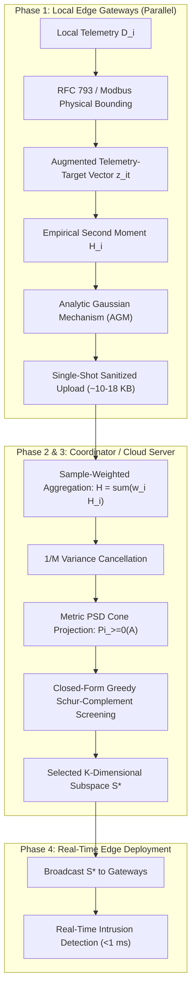

# DP-CoScreen: Algorithmic Architecture and Mathematical Foundations

## Overview
**DP-CoScreen** (**D**ifferentially **P**rivate **C**ollaborative **O**rthogonal **Screen**ing) is an ultra-lightweight, one-shot collaborative feature-screening framework tailored for industrial edge environments (Network Intrusion Detection Systems / NIDS in Industrial IoT).

It resolves the **private feature-selection trilemma**:
1. **Privacy Loss Accumulation**: Avoids iterative multi-round gradient wrappers (e.g. DP-SGD, FedSDG-FS) which degrade privacy under sequential composition.
2. **Feature Multicollinearity**: Prevents univariate selectors (e.g. DP-Corr, Top-R, DPKendall) from selecting mutually redundant, collinear attributes.
3. **Gateway Computational Bottlenecks**: Executes server screening in closed form in $\mathcal{O}(|S| d)$ time per candidate without iterative matrix inversion or gradient backpropagation.

---

## The Four Operational Phases

---

## Phase 1: Client-Side Local Private Statistics Release

Each edge client $i \in \{1, \dots, M\}$ holds local telemetry $D_i = \{(x_{it}, y_{it})\}_{t=1}^{n_i}$ where $x_{it} \in [0, 1]^d$ and $y_{it} \in \{0, 1\}$.

1. **Augmented Telemetry-Target Vector**:
   $$z_{it}^0 = \begin{bmatrix} x_{it} \\ y_{it} \end{bmatrix} \in \mathbb{R}^{d+1}$$
2. **Data-Independent Physical Radius**:
   Attributes are bounded based on physical datasheets and protocol RFC specifications (RFC 793, Modbus Application Protocol Specification V1.1b). The physical radius is:
   $$C_z = \sqrt{d+1}$$
   augmented vectors satisfy $\|z_{it}\|_2 \le \sqrt{d+1}$.
3. **Local Empirical Second Moment**:
   $$H_i^{\mathrm{emp}} = \frac{1}{n_i} \sum_{t=1}^{n_i} z_{it} z_{it}^\top = \begin{bmatrix} A_i & q_i \\ q_i^\top & c_i \end{bmatrix}$$
4. **Global $\ell_2$-Sensitivity**:
   $$\Delta_{2, i} \le \frac{\sqrt{2}(d+1)}{n_i}$$
5. **Analytic Gaussian Mechanism (AGM)**:
   The noise scale $\sigma_i$ is calibrated via the exact root of Balle & Wang (2018):
   $$\Phi\left(\frac{\Delta_{2, i}}{2\sigma_i} - \frac{\epsilon_i \sigma_i}{\Delta_{2, i}}\right) - e^{\epsilon_i} \Phi\left(-\frac{\Delta_{2, i}}{2\sigma_i} - \frac{\epsilon_i \sigma_i}{\Delta_{2, i}}\right) = \delta_i$$
6. **Sanitized Uplink Transmission**:
   $$\widetilde{H}_i = H_i^{\mathrm{emp}} + E_i, \quad E_{i, jj} \sim \mathcal{N}(0, \sigma_i^2), \quad E_{i, jk} \sim \mathcal{N}(0, \sigma_i^2/2) \; (j \neq k)$$
   Payload size: $\frac{(d+1)(d+2)}{2} \times 4$ bytes ($18.24$ KB for ToN-IoT, $10.80$ KB for Edge-IIoTset under float32).

---

## Phase 2: Sample-Weighted Aggregation & PSD Projection

1. **Sample-Weighted Aggregation**:
   $$\widetilde{H} = \sum_{i=1}^M \frac{n_i}{N} \widetilde{H}_i = \begin{bmatrix} \widetilde{A} & \widetilde{q} \\ \widetilde{q}^\top & \widetilde{c} \end{bmatrix}$$
   **Proposition 1 ($\mathcal{O}(1/M)$ Variance Reduction)**:
   $$\operatorname{Var}\left(\sum_{i=1}^M \frac{n_i}{N} E_{i, jk}\right) = \sum_{i=1}^M \left(\frac{n_i}{N}\right)^2 \frac{\sigma_0^2}{n_i^2} = \frac{M \sigma_0^2}{N^2} = \frac{1}{M} \operatorname{Var}_{\mathrm{local}}$$
2. **Metric PSD Cone Projection**:
   $$\Pi_{\succeq 0}(\widetilde{A}) = V \max(\Lambda, 0) V^\top$$
   Restores non-negative residual feature variances and numerical stability under post-processing invariance.

---

## Phase 3: Closed-Form Greedy Schur-Complement Orthogonal Screening

Over the regularized quadratic selection objective:
$$F_\rho(S) = q_S^\top (A_{SS} + \rho I_{|S|})^{-1} q_S$$
The greedy marginal gain for candidate $j \notin S$ decomposes via block Schur complements:
$$\Delta F_\rho(j \mid S) = \frac{(r_j^{(S)})^2}{t_j^{(S)}}$$
where:
- **Orthogonal Residual Task Correlation**:
  $$r^{(S)} = q - A_{:, S}(A_{SS} + \rho I)^{-1} q_S$$
- **Residual Feature Variance**:
  $$t_j^{(S)} = A_{jj} + \rho - A_{j, S}(A_{SS} + \rho I)^{-1} A_{S, j}$$

Conditioning candidates on the currently selected subspace strips multicollinear redundancy in $\mathcal{O}(|S| d)$ time per step.
